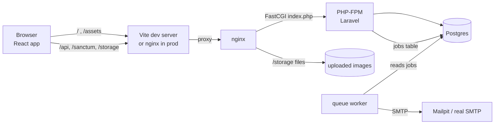

# 02. Architecture

## The big picture



- The **React app** is a static bundle of JavaScript. It renders pages in the
  browser and calls the API for data.
- The **API** is Laravel. It owns every rule: who may do what, what things
  cost, what is valid. It answers in JSON.
- **Postgres** stores everything, including sessions and the job queue.
- The **queue worker** sends e-mails after the HTTP request has already been
  answered.

## Backend folder map

```
backend/
├── routes/api.php            every endpoint, grouped by who may call it
├── app/
│   ├── Http/
│   │   ├── Middleware/       role, approved-operator and suspended-account checks
│   │   ├── Requests/         input validation (Form Requests)
│   │   ├── Controllers/Api/  thin HTTP layer, one folder per audience
│   │   └── Resources/        output shaping: which fields go into the JSON
│   ├── Policies/             "may this user do this to that record?"
│   ├── Services/             business rules: BookingService, WalletService, ...
│   ├── Payments/             PaymentGateway interface + fake implementation
│   ├── Queries/              reporting queries (dashboards)
│   ├── Exports/              CSV exports
│   ├── Models/               Eloquent models: tables, relations, casts, scopes
│   ├── Enums/                roles, statuses, payment methods
│   ├── Notifications/        e-mails
│   ├── Support/              small helpers: image upload, CSV, money, search
│   └── Exceptions/           BusinessRuleException (HTTP 422 with a code)
├── database/
│   ├── migrations/           the schema, including CHECK constraints
│   ├── factories/            fake data for tests and seeders
│   └── seeders/              catalogue + demo data
└── tests/                    Feature (HTTP) and Unit tests
```

## One request, layer by layer

Follow `POST /api/departures/31/bookings` (departure 31 = one date of a tour) with body
`{"spots": 2, "payment_method": "wallet", "discount_code": "WELCOME10"}`.

**1. nginx** (`docker/nginx/dev.conf`) hands the request to PHP's single entry
point, `public/index.php`. No other PHP file can be executed.

**2. Global middleware**: trusted proxies (real client IP), maximum POST size,
trimming strings, converting `""` to `null`.

**3. Sanctum's stateful middleware** (`statefulApi()` in `bootstrap/app.php`):
the request comes from the SPA's origin, so the session cookie is decrypted,
the session is started and the `X-XSRF-TOKEN` header is checked against it.
A forged request from another website fails here with **419**.

**4. Route middleware**, in the order defined by the group in
`routes/api.php`:

| middleware | fails with |
|---|---|
| `auth:sanctum`: is there a logged-in user? | 401 |
| `active`: is the account not suspended? | 403 |
| `verified`: is the e-mail address confirmed? | 403 |
| `role:traveler`: is the user a traveler? | 403 |
| `throttle:bookings`: at most 10 per minute | 429 |

**5. Route model binding** turns `{departure}` = `31` into a `Departure` model (404 if
it does not exist). It runs *after* the role checks (see the priority list in
`bootstrap/app.php`), so a forbidden user never learns which ids exist.

**6. Form Request** [`StoreBookingRequest`](../backend/app/Http/Requests/StoreBookingRequest.php)
validates the body: `spots` is an integer from 1 to 20, `payment_method` is a
known enum value. Failure → **422** with field errors. Fields that are not in
the rules (like a sneaky `price_cents`) never reach the controller.

**7. Controller** [`BookingController::store`](../backend/app/Http/Controllers/Api/BookingController.php)
calls `BookingService::book()` and turns the result into JSON. No rules here.

**8. Service** [`BookingService`](../backend/app/Services/BookingService.php)
opens a transaction, locks the tour row (`FOR SHARE`) and the departure row
(`FOR UPDATE`), checks the tour is bookable, the date has not started and has
2 free spots, asks `PricingService` for the price (database price × spots −
discount), increments the departure's spot counter, creates the booking and debits the
wallet through `WalletService`. A broken rule throws
`BusinessRuleException` → **422** with a `code` such as `not_enough_spots`,
and the transaction rolls everything back.

**9. Resource** [`BookingResource`](../backend/app/Http/Resources/BookingResource.php)
picks the fields to send back.

**10. Notification**: `BookingConfirmedNotification` is pushed to the queue;
the worker sends the e-mail a moment later.

## Response formats

The frontend relies on these shapes:

```jsonc
// success, single item
{ "data": { "id": 7, "reference": "LT-7KQ2M9XA", ... } }

// success, list with pagination
{ "data": [ ... ], "links": { ... }, "meta": { "current_page": 1, "last_page": 3, "total": 52, ... } }

// 422 validation error (Form Request)
{ "message": "The spots field must be at least 1.", "errors": { "spots": ["The spots field must be at least 1."] } }

// 422 business rule (BusinessRuleException)
{ "message": "Only 1 spot(s) left on this tour.", "code": "not_enough_spots" }

// 401 / 403 / 404 / 419 / 429 / 500
{ "message": "..." }
```

In production (`APP_DEBUG=false`) a 500 says only "Server Error". The details
go to the log, never to the visitor.

## Conventions used throughout

- **Every input is validated** by a Form Request or `$request->validate()`.
  Controllers only read `validated()` data.
- **Every output goes through a Resource.** Models are never returned directly.
- **Queries start from the user** when data belongs to someone:
  `$request->user()->tours()`, `$request->user()->bookings()`. Out-of-scope
  records cannot appear by accident.
- **Eager loading** (`with(...)`) on every list. Strict mode throws on lazy
  loading in development, so N+1 query bugs are caught immediately.
- **Enums instead of strings** for roles and statuses, mirrored by `CHECK`
  constraints in the database.
- **Comments explain why.** If you change behaviour, update the comment.
