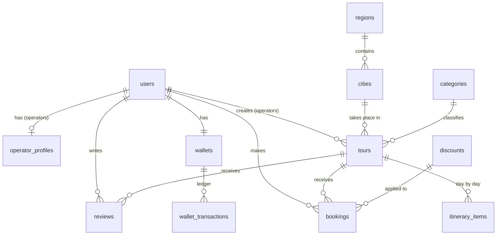

# 04. Database

## The schema



The migrations in [`backend/database/migrations`](../backend/database/migrations)
are the source of truth. Each one is commented.

Compared with the original:

| Original | Now |
|---|---|
| Mixed MyISAM and InnoDB tables, so no transactions or foreign keys on half of them | Postgres: every table is transactional, every relation is a foreign key |
| `state` → `city` hierarchy upside down | `regions` (governorates) contain `cities` |
| Money as `double` and `decimal(10,0)` | Integer cents everywhere |
| `verification_code int` storing a 32-character string | No codes stored: signed URLs (see chapter 03) |
| No unique e-mail | Unique, stored lower-case |
| `status text`, any value accepted | Enum in PHP + `CHECK` constraint in SQL |
| Review = free-text name + image | Review belongs to a real user, one per tour |

## Constraints: the database as last line of defence

PHP validation catches mistakes in requests. Constraints catch everything
else: bugs, race conditions, a script someone runs by hand next year.

| Constraint | Guarantees |
|---|---|
| `wallets_balance_not_negative` | a wallet can never go below $0 |
| `tours_no_overbooking` (`booked_spots <= capacity`) | a tour can never be overbooked |
| `tours_moderated_means_archived` (`moderated_at IS NULL OR status = 'archived'`) | a tour an admin locked stays archived until an admin reinstates it (Exercise 6, D19) |
| `users_pending_email_differs` (`pending_email IS NULL OR pending_email <> email`) | a pending e-mail change is always to a *different* address (Exercise 4, D20). `pending_email` has deliberately **no** unique index, so nobody can block an address by "reserving" it; uniqueness is enforced on `email` at swap time |
| `bookings_totals_consistent` | `subtotal = unit price × spots` and `total = subtotal − discount` |
| `bookings_one_discount_per_user` (partial unique index) | a code is used once per traveler; cancelled bookings don't count |
| `reviews (tour_id, user_id)` unique | one review per traveler and tour |
| `cities (region_id, name)` unique | no duplicate city within a region |
| `*_status_valid`, `users_role_valid` | only known statuses and roles |
| `restrictOnDelete` foreign keys | a city with tours, a user with bookings... cannot be deleted |

There is a test proving the overbooking constraint works even when PHP is
bypassed: `BookingTest::test_the_database_itself_refuses_overbooking`.

Laravel has no schema-builder method for `CHECK` constraints, so the
migrations use `DB::statement('ALTER TABLE ... ADD CONSTRAINT ...')`. That is
normal; not everything needs an abstraction.

### A generated column

```php
$table->integer('duration_days')->storedAs('ends_on - starts_on + 1');
```

Postgres computes the duration from the two dates. It cannot disagree with
them, and the duration filter can use it directly. (The original stored a
duration by hand, displayed it as "hours" on one page and "days" on another,
and filtered it with gaps between the ranges.)

## Money

Amounts are integers in cents: `$129.99` is `12999`.

- Integers add and multiply exactly. Floats do not:
  `0.1 + 0.2 = 0.30000000000000004`.
- Percentages are computed with integer arithmetic and an explicit rounding
  rule: `intdiv(subtotal * percent + 50, 100)` rounds half up
  ([`Discount::amountOffCents`](../backend/app/Models/Discount.php)).
- The API sends and receives cents. Only the React app (and CSV/e-mail
  helpers) turn them into `$129.99` for humans.
- A booking stores a **snapshot** of the unit price. If the operator raises
  the price tomorrow, existing bookings keep what the traveler paid.

## Transactions

A transaction groups several writes into one all-or-nothing unit:

```php
DB::transaction(function () {
    // 1. add 2 to tours.booked_spots
    // 2. insert the booking
    // 3. take $130 from the wallet   ← throws "insufficient funds"
});
// → steps 1 and 2 are undone too, as if nothing happened.
```

The original project ran these steps as separate queries. A failure halfway
left spots taken without a booking, or money gone without spots.

## Locking: making concurrent requests safe

Two travelers click "book" for the last spot at the same moment:

```
Request A                          Request B
SELECT booked_spots → 9 of 10      SELECT booked_spots → 9 of 10
9 + 1 ≤ 10 ✓                       9 + 1 ≤ 10 ✓
UPDATE booked_spots = 10           UPDATE booked_spots = 10
→ two bookings, one spot.
```

The fix is a **row lock**:

```php
$tour = Tour::query()->whereKey($id)->lockForUpdate()->first();
// SQL: SELECT ... FOR UPDATE
```

The second request waits at that line until the first transaction commits,
then reads `booked_spots = 10` and is refused. The same pattern protects
wallet balances (`WalletService`) and discount redemption counters.

Rules of thumb:

- Lock **inside** a transaction (outside one, the lock is released at once).
- Lock **before** reading the values you will check.
- Keep locked transactions **short**. Never call an external service (a
  payment provider, an e-mail server) while holding a lock. Chapter 05 shows
  how card payments avoid it.

## Querying safely and efficiently

**Parameter binding.** Every value goes into SQL as a bound parameter. The
original project mostly did this right; keep doing it. Never build SQL with
string concatenation of user input, not even "after `intval()`".

**LIKE wildcards.** Binding prevents SQL injection, but `%` and `_` are still
wildcards inside a `LIKE` pattern. [`Search::containsPattern`](../backend/app/Support/Search.php)
escapes them, so searching for "100%" finds "100%", not everything.

**Eager loading (the N+1 problem).** Listing 12 tours and showing each
tour's city with `$tour->city` inside a loop runs 1 + 12 queries. With
`Tour::with('city')` it runs 2. Strict mode (`Model::shouldBeStrict()` in
`AppServiceProvider`) makes lazy loading throw an exception in development, so
you notice immediately.

**Aggregate in the database.** Dashboards use `COUNT`, `SUM` and
`GROUP BY` ([`BookingStats`](../backend/app/Queries/BookingStats.php)) rather
than loading every booking into PHP.

**Indexes** exist for the columns used in `WHERE` and `ORDER BY` of frequent
queries (e.g. `tours (status, starts_on)` for the public listing). Foreign
keys are indexed by `foreignId()->constrained()`.

## Strict mode and model defaults: a lesson from building this project

While writing the tests, 52 of them failed at once with
`MissingAttributeException: The attribute [suspended_at] either does not
exist or was not retrieved`.

The cause: after `User::create([...])`, the PHP object only contains the
attributes we set. The database filled `suspended_at` with its default
(`NULL`), but the object does not know that. Normally Eloquent silently
returns `null` for missing attributes, which hides real bugs (a typo in a
column name also returns `null`). Strict mode turns that into an error.

The fix is to declare the defaults on the model as well, so the object and
the row agree:

```php
protected $attributes = [
    'role' => 'traveler',
    'phone' => null,
    'suspended_at' => null,
];
```

Columns *computed* by the database (like `duration_days`) cannot be known in
advance, so `TourService` calls `$tour->refresh()` after saving.

## Changing the schema

Never edit a migration that has already run on someone else's machine or on
production. Create a new one:

```bash
make artisan c="make:migration add_meeting_point_to_tours"
```

```php
public function up(): void
{
    Schema::table('tours', function (Blueprint $table) {
        $table->string('meeting_point')->nullable();
    });
}

public function down(): void
{
    Schema::table('tours', function (Blueprint $table) {
        $table->dropColumn('meeting_point');
    });
}
```

Then `make migrate`. Add the column to the model's `#[Fillable]`, the Form
Request rules, the Resource, the frontend type, and a test.
