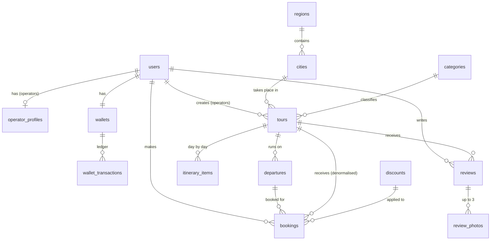

# 04. Database

## The schema



The migrations in [`backend/database/migrations`](../backend/database/migrations)
are the source of truth. Each one is commented.

Compared with the original:

| Original | Now |
|---|---|
| Mixed MyISAM and InnoDB tables, so no transactions or foreign keys on half of them | Postgres: every table is transactional, every relation is a foreign key |
| `state` → `city` hierarchy upside down | `regions` (governorates) contain `cities` |
| Money as `double` and `decimal(10,0)` | Integer cents everywhere |
| `verification_code int` storing a 32-character string | No codes stored: signed URLs (see chapter 03) |
| No unique e-mail | Unique, stored lower-case |
| `status text`, any value accepted | Enum in PHP + `CHECK` constraint in SQL |
| Review = free-text name + image | Review belongs to a real user, one per tour |

## Constraints: the database as last line of defence

PHP validation catches mistakes in requests. Constraints catch everything
else: bugs, race conditions, a script someone runs by hand next year.

| Constraint | Guarantees |
|---|---|
| `wallets_balance_not_negative` | a wallet can never go below $0 |
| `departures_no_overbooking` (`booked_spots <= capacity`) + `departures_booked_spots_not_negative` (`booked_spots >= 0`) | a departure (one date of a tour) can never be overbooked, and a double release of spots cannot go below zero. Laravel's `unsignedSmallInteger` is a plain signed `smallint` in Postgres, so only the CHECK stops negatives (Exercise 10, D23) |
| `departures_one_per_day` unique `(tour_id, starts_on)` | a tour runs at most once per day |
| `bookings_departure_of_tour_foreign`: FK `bookings (departure_id, tour_id)` → `departures (id, tour_id)` | a booking's denormalised `tour_id` is always the tour of its departure (D23) |
| `tours_duration_range` (`duration_days BETWEEN 1 AND 30`) | every departure's end date (`starts_on + duration_days − 1`) is on or after its start |
| `tours_moderated_means_archived` (`moderated_at IS NULL OR status = 'archived'`) | a tour an admin locked stays archived until an admin reinstates it (Exercise 6, D19) |
| `users_pending_email_differs` (`pending_email IS NULL OR pending_email <> email`) | a pending e-mail change is always to a *different* address (Exercise 4, D20). `pending_email` has deliberately **no** unique index, so nobody can block an address by "reserving" it; uniqueness is enforced on `email` at swap time |
| `bookings_totals_consistent` | `subtotal = unit price × spots` and `total = subtotal − discount` |
| `bookings_one_discount_per_user` (partial unique index) | a code is used once per traveler; cancelled bookings don't count |
| `reviews (tour_id, user_id)` unique | one review per traveler and tour |
| `review_photos_position_range` (`position BETWEEN 1 AND 3`) + `review_photos (review_id, position)` unique | at most three photos per review, each in its own slot (Exercise 8, D21). Photo rows cascade with their review; the *files* are deleted by `ReviewService` after the commit, since the database cannot touch the disk |
| `cities (region_id, name)` unique | no duplicate city within a region |
| `*_status_valid`, `users_role_valid` | only known statuses and roles |
| `restrictOnDelete` foreign keys | a city with tours, a user with bookings... cannot be deleted |

There is a test proving the overbooking constraint works even when PHP is
bypassed: `DepartureDataModelTest::test_the_database_refuses_overbooking_a_departure`.

Laravel has no schema-builder method for `CHECK` constraints, so the
migrations use `DB::statement('ALTER TABLE ... ADD CONSTRAINT ...')`. That is
normal; not everything needs an abstraction.

### The tour's length: from a generated column to a plain one

Until Exercise 10, `duration_days` was a *generated* column:

```php
$table->integer('duration_days')->storedAs('ends_on - starts_on + 1');
```

Postgres computed it from the tour's two dates, so it could not disagree
with them. (The original stored a duration by hand, displayed it as "hours"
on one page and "days" on another, and filtered it with gaps between the
ranges.)

Since Exercise 10 a tour has no dates of its own: it runs on departures. The
length is now entered by the operator and is the length of *every*
departure: a departure stores only `starts_on`, and its end date is computed
as `starts_on + duration_days − 1`. The migration turned the generated column
into a plain one with `ALTER COLUMN duration_days DROP EXPRESSION`, which keeps
every value. One length per tour is what keeps the itinerary ("Day 3: ...")
true for every date.

## Money

Amounts are integers in cents: `$129.99` is `12999`.

- Integers add and multiply exactly. Floats do not:
  `0.1 + 0.2 = 0.30000000000000004`.
- Percentages are computed with integer arithmetic and an explicit rounding
  rule: `intdiv(subtotal * percent + 50, 100)` rounds half up
  ([`Discount::amountOffCents`](../backend/app/Models/Discount.php)).
- The API sends and receives cents. Only the React app (and CSV/e-mail
  helpers) turn them into `$129.99` for humans.
- A booking stores a **snapshot** of the unit price. If the operator raises
  the price tomorrow, existing bookings keep what the traveler paid.

## Transactions

A transaction groups several writes into one all-or-nothing unit:

```php
DB::transaction(function () {
    // 1. add 2 to departures.booked_spots
    // 2. insert the booking
    // 3. take $130 from the wallet   ← throws "insufficient funds"
});
// → steps 1 and 2 are undone too, as if nothing happened.
```

The original project ran these steps as separate queries. A failure halfway
left spots taken without a booking, or money gone without spots.

## Locking: making concurrent requests safe

Two travelers click "book" for the last spot at the same moment:

```
Request A                          Request B
SELECT booked_spots → 9 of 10      SELECT booked_spots → 9 of 10
9 + 1 ≤ 10 ✓                       9 + 1 ≤ 10 ✓
UPDATE booked_spots = 10           UPDATE booked_spots = 10
→ two bookings, one spot.
```

The fix is a **row lock**:

```php
$departure = Departure::query()->whereKey($id)->lockForUpdate()->first();
// SQL: SELECT ... FOR UPDATE
```

The second request waits at that line until the first transaction commits,
then reads `booked_spots = 10` and is refused. The same pattern protects
wallet balances (`WalletService`) and discount redemption counters.

Since Exercise 10 the counter lives on the **departure** (one date), not the
tour. `BookingService` takes two locks, always in the same order: the tour
`FOR SHARE` (its price and status cannot change until we commit, yet bookings
for *other* dates of the same tour don't wait for each other), then the
departure `FOR UPDATE`. One lock order everywhere means no deadlocks.
`BookingTest::test_the_departure_row_is_locked_before_its_spots_are_counted`
checks the query log for both locks and their order; PHPUnit cannot send two
truly parallel requests inside `RefreshDatabase`'s single transaction.

Rules of thumb:

- Lock **inside** a transaction (outside one, the lock is released at once).
- Lock **before** reading the values you will check.
- Keep locked transactions **short**. Never call an external service (a
  payment provider, an e-mail server) while holding a lock. Chapter 05 shows
  how card payments avoid it.

## Querying safely and efficiently

**Parameter binding.** Every value goes into SQL as a bound parameter. The
original project mostly did this right; keep doing it. Never build SQL with
string concatenation of user input, not even "after `intval()`".

**LIKE wildcards.** Binding prevents SQL injection, but `%` and `_` are still
wildcards inside a `LIKE` pattern. [`Search::containsPattern`](../backend/app/Support/Search.php)
escapes them, so searching for "100%" finds "100%", not everything.

**Eager loading (the N+1 problem).** Listing 12 tours and showing each
tour's city with `$tour->city` inside a loop runs 1 + 12 queries. With
`Tour::with('city')` it runs 2. Strict mode (`Model::shouldBeStrict()` in
`AppServiceProvider`) makes lazy loading throw an exception in development, so
you notice immediately.

**Aggregate in the database.** Dashboards use `COUNT`, `SUM` and
`GROUP BY` ([`BookingStats`](../backend/app/Queries/BookingStats.php)) rather
than loading every booking into PHP.

**Indexes** exist for the columns used in `WHERE` and `ORDER BY` of frequent
queries (e.g. `departures (tour_id, starts_on)`, the unique index that also
answers "does this tour have an upcoming date?" and "when is its next date?"
for the public listing).

**Foreign keys are *not* indexed automatically.** MySQL creates an index for
every foreign key; Postgres does not, and `foreignId()->constrained()` only
adds the constraint. A foreign key column gets an index only when a migration
asks for one, or when it leads a unique or composite index (e.g.
`departures (tour_id, starts_on)`). Add one when a frequent query filters or
joins on the column, and measure first: `tours.city_id` got its index in
Exercise 11 because the search needed it; `tours.operator_id` and
`tours.category_id` have none yet.

**Fast "contains" search (Exercise 11, D24).** The public search is
`title ILIKE '%term%' OR city_id IN (...)`. A btree index cannot answer a
pattern that starts with `%`, so Postgres read every tour. Two indexes and one
query change fix it:

- `tours_title_trgm`, a GIN index from the `pg_trgm` extension. It splits text
  into three-letter pieces ("hik", "ike", ...) and finds the rows that contain
  every piece of the term; Postgres then re-checks the real `ILIKE` on those
  rows, so results are exactly what `ILIKE` gives. Full-text search
  (`to_tsvector`) was rejected: it matches whole words, so "byb" would no
  longer find Byblos.
- `tours_city_id_index`. An `OR` can only be answered from indexes (a
  `BitmapOr`) when **both** sides have one.
- The matching cities are looked up first and their ids bound as values. With
  `OR EXISTS (select ... from cities ...)` Postgres can use neither index, and
  with a subquery it has to guess how many tours match.

Terms shorter than three letters (e.g. "by") have no trigram and still scan
the table. Always check with `EXPLAIN ANALYZE` on realistic data: on a few
rows a sequential scan is always cheapest, so the plan of a dev database says
nothing. The 100,000-tour benchmark lives in
[`backend/database/benchmarks/`](../backend/database/benchmarks/) and its
results in [exercises/11-faster-search.md](exercises/11-faster-search.md).

## Strict mode and model defaults: a lesson from building this project

While writing the tests, 52 of them failed at once with
`MissingAttributeException: The attribute [suspended_at] either does not
exist or was not retrieved`.

The cause: after `User::create([...])`, the PHP object only contains the
attributes we set. The database filled `suspended_at` with its default
(`NULL`), but the object does not know that. Normally Eloquent silently
returns `null` for missing attributes, which hides real bugs (a typo in a
column name also returns `null`). Strict mode turns that into an error.

The fix is to declare the defaults on the model as well, so the object and
the row agree:

```php
protected $attributes = [
    'role' => 'traveler',
    'phone' => null,
    'suspended_at' => null,
];
```

Columns *computed* by the database (like `duration_days` was before Exercise
10) cannot be known in advance, so `TourService` calls `$tour->refresh()` after
saving.

## Changing the schema

Never edit a migration that has already run on someone else's machine or on
production. Create a new one:

```bash
make artisan c="make:migration add_meeting_point_to_tours"
```

```php
public function up(): void
{
    Schema::table('tours', function (Blueprint $table) {
        $table->string('meeting_point')->nullable();
    });
}

public function down(): void
{
    Schema::table('tours', function (Blueprint $table) {
        $table->dropColumn('meeting_point');
    });
}
```

Then `make migrate`. Add the column to the model's `#[Fillable]`, the Form
Request rules, the Resource, the frontend type, and a test.

## Moving data between tables: expand, migrate, contract (Exercise 10)

Adding a column is easy. *Moving* data is not: dates, capacity and the spot
counter moved from `tours` to a new `departures` table, and every booking had
to be attached to a departure. The plan was written before any code
([D23](decisions.md)), in three migrations:

| Step | Migration | What it does | `down()` |
|---|---|---|---|
| Expand | `2026_11_26_000100_create_departures_table` | new table with its constraints; nothing reads it yet | drops it |
| Migrate | `2026_11_26_000200_move_bookings_to_departures` | one `INSERT ... SELECT`: each tour becomes one departure (a tour had exactly one date, so nothing is guessed); `bookings.departure_id` added nullable, filled with one `UPDATE ... FROM`, then made `NOT NULL`; composite FK | copies date, capacity and counter back to the tours, drops the column, deletes the departures |
| Contract | `2026_11_26_000300_drop_dates_and_capacity_from_tours` | `duration_days` becomes a plain column; `capacity`, `booked_spots`, `starts_on`, `ends_on` dropped | restores them from each tour's departure |

Things worth noticing:

- **Inside the database.** The copies are single SQL statements: no row
  passes through PHP, and Postgres runs DDL in the migration's transaction,
  so a migration applies completely or not at all.
- **Nullable, backfill, then NOT NULL.** A NOT NULL column without a default
  cannot be added to a table that already has rows.
- **A rollback that refuses.** The old shape holds one date per tour. Once a
  tour has several departures (or none), `down()` would have to drop or
  invent data, so it throws instead, naming the tours. A rollback is either
  exact or does not happen.
- **One release or two.** In a zero-downtime deploy the contract step ships
  one release later, once no running code reads the old columns. Here code
  and migrations deploy together, so all three run at once.
- **Tested both ways.** `DepartureDataModelTest` rolls the migrations back
  inside the test transaction, inserts rows in the *old* shape with plain SQL,
  runs them forward and checks rows in and out, then checks each `down()`.
