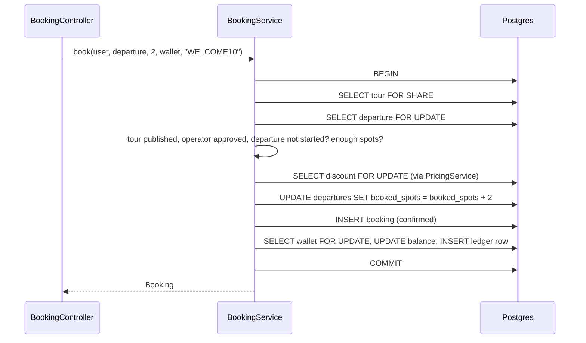

# 05. Bookings and payments

All the code for this chapter is in three files:
[`BookingService`](../backend/app/Services/BookingService.php),
[`PricingService`](../backend/app/Services/PricingService.php) and
[`WalletService`](../backend/app/Services/WalletService.php).

## Tours, departures and bookings (Exercise 10)

A **tour** is the product: title, itinerary, price, length in days. A
**departure** is one date it runs on, with its own group size (`capacity`) and
`booked_spots` counter: the same tour can run every Saturday. A traveler
books a departure; the booking keeps both `departure_id` and (denormalised,
guarded by a composite foreign key) `tour_id`. The price stays on the tour,
and each booking snapshots it. See [D23](decisions.md) for why, and chapter
04 for how the existing data was moved.

Operators manage departures on the tour's edit page:

| Endpoint (operator group) | Rule |
|---|---|
| `GET /api/operator/tours/{tour}/departures` | all dates of my tour, with booking counts |
| `POST /api/operator/tours/{tour}/departures` | `starts_on` (after today), `capacity` (1–500), optional `weeks` (1–26): a weekly series, all or nothing; a taken date → 422 on `starts_on` |
| `PUT /api/operator/departures/{departure}` | new date and/or capacity. Capacity below the booked spots → `capacity_below_bookings`; moving a departure that has any booking (even cancelled) → `departure_has_bookings`; a started departure → `departure_started` |
| `DELETE /api/operator/departures/{departure}` | refused with `departure_has_bookings` if it has any booking, `departure_started` if it started |

Ownership is `TourPolicy::update` on the departure's tour (`DeparturePolicy`
delegates to it). For create and update the check is in the Form Request's
`authorize()`, which runs *before* validation: otherwise the "date already
taken" error would tell any operator which dates another operator's tour
runs on. `DepartureService` checks bookings under `FOR UPDATE` on the
departure, the lock a booking takes before counting spots, so a capacity
change and a booking of the same date never interleave.

## Rule number one: the server decides the price

The original booking page put the price in a hidden form field and the server
trusted it. Editing that field (two clicks in the browser's dev tools) made
any tour free. A negative number of spots even *added* money to the wallet.

Here the client sends only **what** it wants:

```json
{ "spots": 2, "payment_method": "wallet", "discount_code": "WELCOME10" }
```

and the server computes **what it costs**, from the database. Extra fields
such as `"price_cents": 1` are ignored, because the controller only reads
validated fields. `BookingTest::test_the_price_sent_by_the_client_is_ignored`
proves it.

## The quote endpoint

The checkout page still needs to show a total before the traveler confirms.
Instead of computing it in JavaScript (which would duplicate the rules and
drift apart), it asks the server:

```
POST /api/departures/31/quote   {"spots": 2, "discount_code": "WELCOME10"}
→ {"data": {"unit_price_cents": 6500, "subtotal_cents": 13000,
            "discount_cents": 1300, "total_cents": 11700, ...}}
```

The quote and the real booking both call `PricingService::quote()`, so the
number on the screen is exactly what will be charged.

## Discount codes

A code can be fixed (`value` in cents) or percent (`value` 1-100), with
optional start date, expiry and maximum number of uses. A code is refused
when it is inactive, not started, expired, fully redeemed, or already used by
this traveler. Each reason has its own message (`Discount::unavailableReason`).

Counting uses is race-safe: the discount row is locked while booking, and the
partial unique index `bookings_one_discount_per_user` backs up the
"once per traveler" rule in the database. Cancelling a booking gives the use
back.

## Booking with the wallet

One transaction, as described in [chapter 04](04-database.md#transactions):



If anything throws (sold out, insufficient funds, invalid code), Postgres
rolls back every step.

## The wallet ledger

`wallets.balance_cents` says *how much*. `wallet_transactions` says *why*:
every credit and debit, the balance after it, a description, the booking it
belongs to and, for manual credits, the admin who added it. Rows are never
updated or deleted.

A good habit for any money feature: you should be able to rebuild the
balance by replaying the ledger. That is a nice exercise query:

```sql
SELECT w.id, w.balance_cents,
       SUM(CASE t.type WHEN 'credit' THEN t.amount_cents ELSE -t.amount_cents END) AS ledger_sum
FROM wallets w LEFT JOIN wallet_transactions t ON t.wallet_id = w.id
GROUP BY w.id;
```

## Booking with a card

Card payments involve someone else's server, which can be slow or
unavailable. Holding the departure lock while waiting would block every other
traveler trying to book that date. So the flow has three short steps:

```mermaid
sequenceDiagram
    participant S as BookingService
    participant DB as Postgres
    participant G as PaymentGateway
    S->>DB: transaction 1: lock tour (share) and departure, check, hold spots, booking = pending
    S->>G: charge(total)  (no transaction open)
    alt approved
        S->>DB: transaction 2: lock booking; still pending → confirmed, store payment reference
        Note over S,DB: already expired → stays failed, amount credited to wallet (booking_expired)
    else declined
        S->>DB: transaction 2: give spots back, booking = failed
    end
```

`PaymentGateway` is an interface. The only implementation is
[`FakePaymentGateway`](../backend/app/Payments/FakePaymentGateway.php), which
approves everything in development and declines everything in production.
**The frontend never asks for a card number.** With a real provider, the card
is typed into the provider's own form (Stripe Checkout, Stripe Elements, ...)
and our server only sees a payment id. That keeps card data off our servers,
which is both safer and required by the card industry's rules (PCI DSS).

### Stale pending bookings (Exercise 5)

If the server crashes between "charge" and "confirm", nothing ever confirms
or releases the booking: it would stay `pending` and hold its spots (and its
discount use) forever. The scheduler runs `bookings:expire-pending` every
minute ([`routes/console.php`](../backend/routes/console.php)). It calls
`BookingService::expireStalePending()`, which finds card bookings still
`pending` after `config('payments.pending_timeout_minutes')` (15) and, **one
short transaction per booking**, locks the booking, re-checks that it is still
pending and still too old, then releases the spots and the discount use and
marks it `failed`. Because of the re-check, running it twice (or twice at
once) changes nothing the second time. It can be run by hand:

```bash
docker compose exec php php artisan bookings:expire-pending
```

The other side of the race is `markPaid()`. A charge that takes longer than
the timeout could succeed *after* its booking was expired and its spots given
to someone else. So `markPaid()` also locks the booking and confirms it only
if it is still `pending`. Otherwise the booking stays `failed`, the charged
amount is credited to the traveler's wallet as travel credit (we know the
card was charged), and the request fails with the code `booking_expired`.

What it does **not** do: refund a booking expired after a crash. We cannot
ask the fake gateway whether that card was charged, and crediting a card that
was never charged would hand out money. Each expiry is logged (warning, with
the booking reference) for manual reconciliation. With a real provider, its
webhook (Exercise 9) is what settles that case. See
[D18](decisions.md#d18-stale-pending-card-bookings-expire-after-15-minutes).

## Cancelling

Travelers can cancel a confirmed booking until its departure starts. In one
transaction: the spots go back to the departure, the discount use is returned, the
booking becomes `cancelled`, and the full amount is credited to the
traveler's **wallet** as travel credit, whatever the original payment method.

That refund policy is a *product decision*, not a technical one. Many travel
companies refund as credit; others refund the card, some keep a fee. Changing
the policy means changing `BookingService::cancel()` and its test, nothing
else.

## Booking statuses

| Status | Meaning | Holds spots? |
|---|---|---|
| `pending` | card payment in progress | yes |
| `confirmed` | paid | yes |
| `cancelled` | cancelled by the traveler, refunded | no |
| `failed` | card declined | no |
