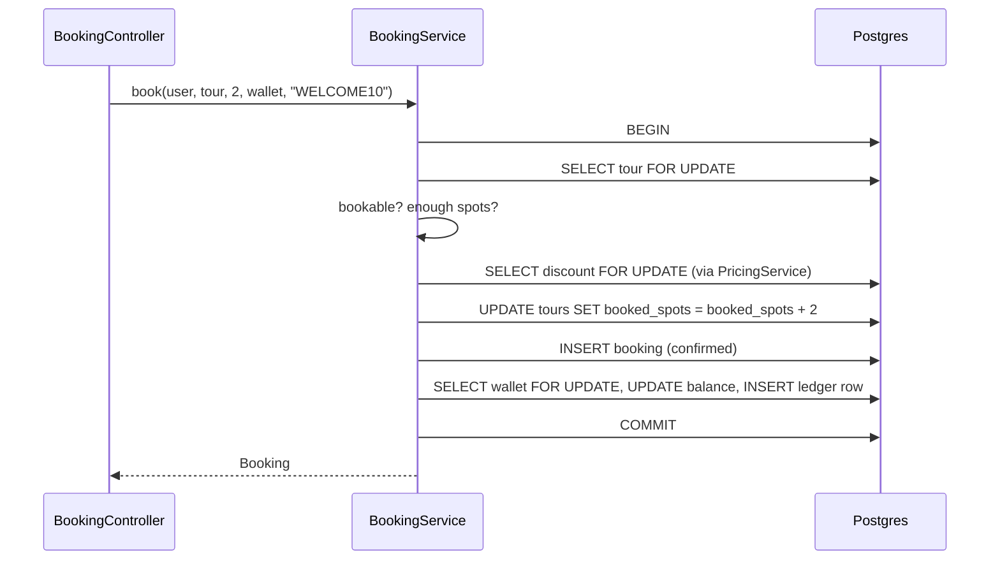
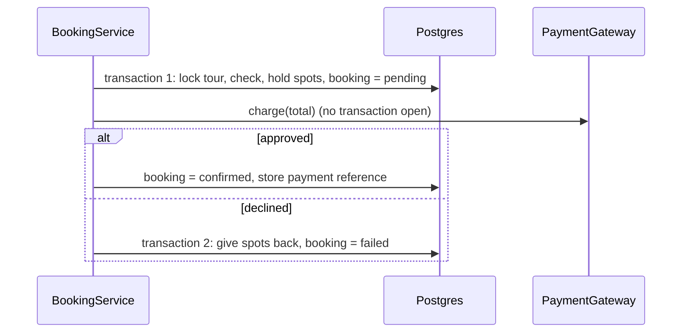

# 05. Bookings and payments

All the code for this chapter is in three files:
[`BookingService`](../backend/app/Services/BookingService.php),
[`PricingService`](../backend/app/Services/PricingService.php) and
[`WalletService`](../backend/app/Services/WalletService.php).

## Rule number one: the server decides the price

The original booking page put the price in a hidden form field and the server
trusted it. Editing that field (two clicks in the browser's dev tools) made
any tour free. A negative number of spots even *added* money to the wallet.

Here the client sends only **what** it wants:

```json
{ "spots": 2, "payment_method": "wallet", "discount_code": "WELCOME10" }
```

and the server computes **what it costs**, from the database. Extra fields
such as `"price_cents": 1` are ignored, because the controller only reads
validated fields. `BookingTest::test_the_price_sent_by_the_client_is_ignored`
proves it.

## The quote endpoint

The checkout page still needs to show a total before the traveler confirms.
Instead of computing it in JavaScript (which would duplicate the rules and
drift apart), it asks the server:

```
POST /api/tours/12/quote   {"spots": 2, "discount_code": "WELCOME10"}
→ {"data": {"unit_price_cents": 6500, "subtotal_cents": 13000,
            "discount_cents": 1300, "total_cents": 11700, ...}}
```

The quote and the real booking both call `PricingService::quote()`, so the
number on the screen is exactly what will be charged.

## Discount codes

A code can be fixed (`value` in cents) or percent (`value` 1-100), with
optional start date, expiry and maximum number of uses. A code is refused
when it is inactive, not started, expired, fully redeemed, or already used by
this traveler. Each reason has its own message (`Discount::unavailableReason`).

Counting uses is race-safe: the discount row is locked while booking, and the
partial unique index `bookings_one_discount_per_user` backs up the
"once per traveler" rule in the database. Cancelling a booking gives the use
back.

## Booking with the wallet

One transaction, as described in [chapter 04](04-database.md#transactions):



If anything throws (sold out, insufficient funds, invalid code), Postgres
rolls back every step.

## The wallet ledger

`wallets.balance_cents` says *how much*. `wallet_transactions` says *why*:
every credit and debit, the balance after it, a description, the booking it
belongs to and, for manual credits, the admin who added it. Rows are never
updated or deleted.

A good habit for any money feature: you should be able to rebuild the
balance by replaying the ledger. That is a nice exercise query:

```sql
SELECT w.id, w.balance_cents,
       SUM(CASE t.type WHEN 'credit' THEN t.amount_cents ELSE -t.amount_cents END) AS ledger_sum
FROM wallets w LEFT JOIN wallet_transactions t ON t.wallet_id = w.id
GROUP BY w.id;
```

## Booking with a card

Card payments involve someone else's server, which can be slow or
unavailable. Holding the tour lock while waiting would block every other
traveler trying to book that tour. So the flow has three short steps:



`PaymentGateway` is an interface. The only implementation is
[`FakePaymentGateway`](../backend/app/Payments/FakePaymentGateway.php), which
approves everything in development and declines everything in production.
**The frontend never asks for a card number.** With a real provider, the card
is typed into the provider's own form (Stripe Checkout, Stripe Elements, ...)
and our server only sees a payment id. That keeps card data off our servers,
which is both safer and required by the card industry's rules (PCI DSS).

Known gap, left as an exercise: if the server crashed between "charge" and
"confirm", the booking would stay `pending`. Real integrations handle this
with the provider's webhooks and a scheduled job that expires old pending
bookings. See [10-exercises.md](10-exercises.md).

## Cancelling

Travelers can cancel a confirmed booking until the tour starts. In one
transaction: the spots go back to the tour, the discount use is returned, the
booking becomes `cancelled`, and the full amount is credited to the
traveler's **wallet** as travel credit, whatever the original payment method.

That refund policy is a *product decision*, not a technical one. Many travel
companies refund as credit; others refund the card, some keep a fee. Changing
the policy means changing `BookingService::cancel()` and its test, nothing
else.

## Booking statuses

| Status | Meaning | Holds spots? |
|---|---|---|
| `pending` | card payment in progress | yes |
| `confirmed` | paid | yes |
| `cancelled` | cancelled by the traveler, refunded | no |
| `failed` | card declined | no |
